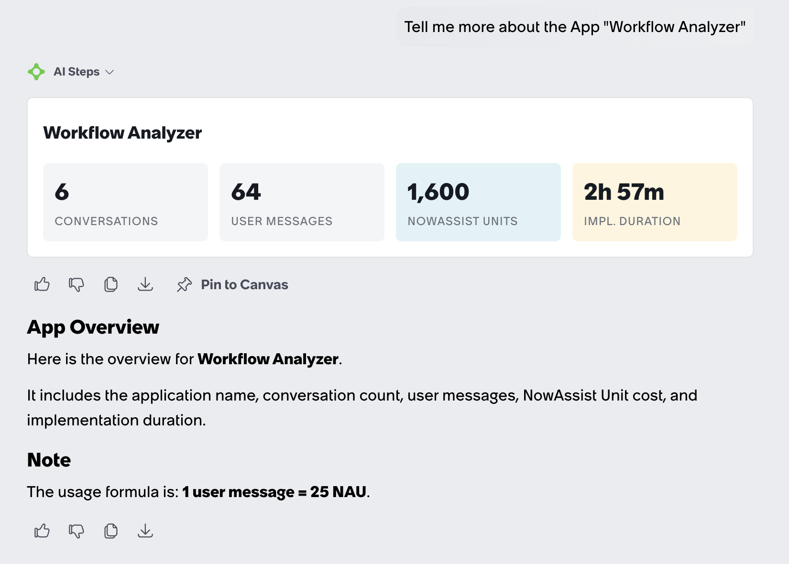
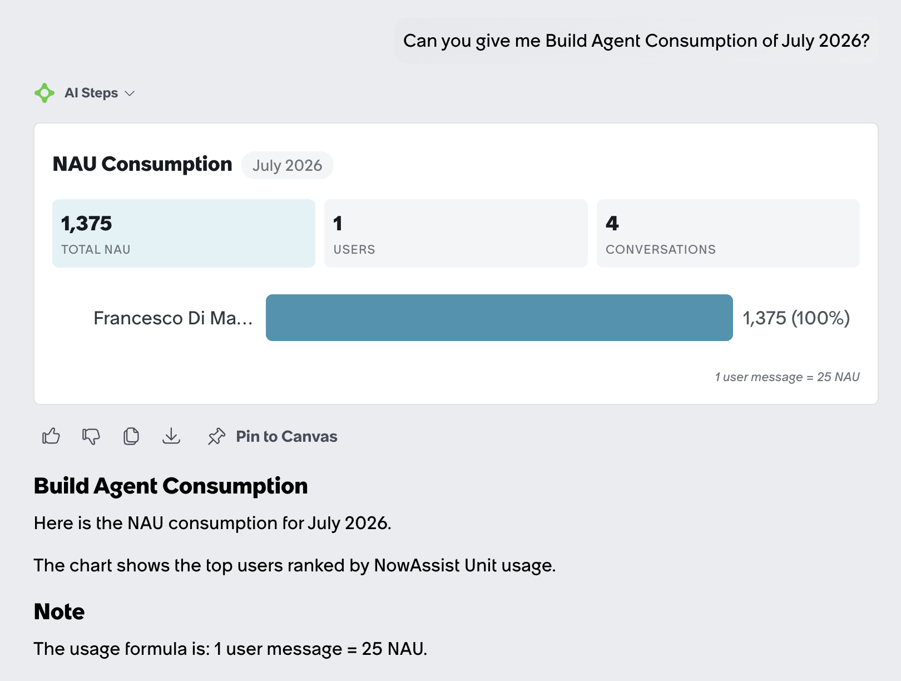
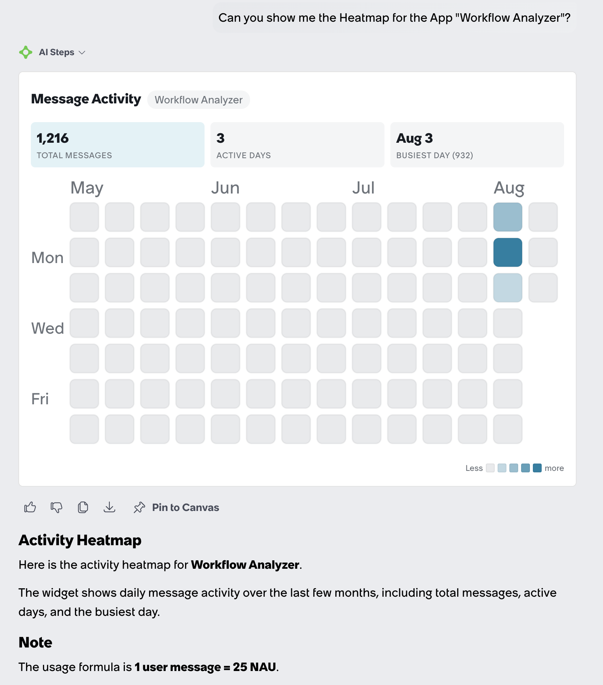

# Build Agent Analytics

Dashboard analytics application for visualizing **Build Agent** usage statistics — including conversations, messages, checkpoints, application compositions, token consumption, NAU (Now Assist Units) tracking, per-user profiling, time-series analysis, and agent performance metrics.

Built on ServiceNow using the **Now SDK Fluent DSL** (v4.13.3) with a React-based UI Page (SPA).

---

> ⚠️ **Before installing on a new instance:** check the instance's `glide.appcreator.company.code` system property and make sure it matches the app scope prefix (`x_snc_...`). A mismatch causes `npm run deploy` to fail with `Unable to install application as application was null`. Fixing it requires updating `scope`/`scopeId` in `now.config.json` **and** renaming every `x_snc_build_agranx*` reference across `src/` — the build does not do this automatically. See [Prerequisites](#prerequisites) for details.

---

## Features

| View | Description |
|------|-------------|
| **Applications** | Lists all applications touched by Build Agent, with conversation/checkpoint counts, global KPI cards, and search |
| **App Detail** | Deep dive into a single application — full metadata composition with deep-links, related conversations, usage by author, implementation duration, and partner-hour savings calculator |
| **Conversation Detail** | Full conversation thread with messages (user, assistant, thinking, tool calls), token usage, NAU breakdown, message search, Markdown/Mermaid rendering, and **export to printable HTML/PDF** |
| **Conversation Coaching** | Within Conversation Detail: prepare a prompt/response preview, select GPT-5.6 Sol or Opus 5 when available through One Extend, and generate concise coaching with specific prompt rewrites and linked evidence |
| **Consumption** | Monthly NAU consumption per user, with month navigation, search, and drill-down to individual user profiles |
| **User Profile** | Individual user analytics — donut chart of top 5 apps, per-app breakdown table, daily activity timeline bar chart, and lifetime KPIs |
| **Performance** | Agent-level KPIs — task telemetry, build-fix cycles, and tool error rates |
| **TimeSeries** | Per-application daily token consumption and message volume over time, with dual-axis SVG line chart and server-side caching |

The top navigation exposes three tabs — **Applications**, **Consumption**, **Performance**. Three further views (App Detail, Conversation Detail, User Profile) are reached by drill-down and are deep-linkable via URL parameters. **TimeSeries** has no drill-down entry point today: it is only reachable via the deep-link `?view=timeseries`.

### Additional Capabilities

- **Conversation Export (PDF)** — generates a self-contained HTML transcript (cover page, KPI summary, token usage, NAU breakdown, full message thread with attachments, thinking steps and tool calls) opened in a new tab and print-optimized for A4
- **Run Script Viewer** — dedicated modal for `run_script` tool calls, showing the executed script and its result side by side with copy-to-clipboard (read-only; it never re-executes anything)
- **KPI Cards & Info Modals** — at-a-glance metrics, each card clickable to reveal what the KPI means, how it is calculated, and its detail breakdown
- **DataTable** — reusable sortable/expandable table component with row click navigation
- **Build Error Display** — structured visualization of build errors and fix cycles
- **Markdown & Mermaid Rendering** — rich content display for agent messages and summaries
- **Live Query Telemetry** — every API call is wrapped in a tracker that reports label, status and elapsed time in a loading modal, so slow queries are visible while a view loads
- **Skeleton Loading** — per-view skeleton placeholders (KPI rows, tables, headers) while data resolves
- **Per-user Settings** — complexity weights and partner-hour estimates persisted per user in a custom table
- **Complexity Scoring** — weighted heuristic estimation of application complexity across 24 metadata types, with user-editable weights
- **ROI / Partner-Hour Estimates** — calculates manual development hours saved by Build Agent
- **Token Estimation** — approximate token usage from message content, bucketed into input/output/thinking
- **Implementation Duration** — computes actual interaction time from turn-based message intervals, plus wall-clock, average interaction and average pause metrics
- **App Composition Scanner** — scans 24 metadata types per application with deep-link URLs to each record; missing plugins are skipped without failing the scan
- **SVG Charting** — pure SVG dual-axis line charts, donut pie charts, and bar charts (no charting library)
- **SPA Routing** — URL-parameter-based navigation with browser history support and Magellan integration

---

## Tech Stack

| Layer | Technology |
|-------|-----------|
| Frontend | React 18.2, TypeScript |
| Rendering | [marked](https://github.com/markedjs/marked) 12.0.2 (Markdown), [mermaid](https://mermaid.js.org/) 10.9.3 (diagrams) |
| Charts | Pure SVG (no charting library) |
| Platform | ServiceNow (Table API, Aggregate/Stats API, UI Page) |
| SDK | `@servicenow/sdk` 4.13.3 (Fluent DSL), `@servicenow/glide` 27.0.5 |

---

## ServiceNow Tables Used

### Platform Tables (read-only)

| Table | Purpose |
|-------|---------|
| `sn_build_agent_conversation` | Build Agent conversations |
| `sn_build_agent_message` | Individual messages within conversations |
| `sn_build_agent_checkpoint` | Install checkpoints per conversation |
| `sn_build_agent_task_telemetry` | Task-level performance telemetry |
| `sn_build_agent_event_telemetry` | Event-level telemetry (steps within a task) |
| `sys_app` | Application name/description resolution |
| `sys_user` | User profile name resolution |

### Application Composition (scanned per app scope)

Each table is queried with `sys_scope=<appId>`; tables belonging to uninstalled plugins are skipped silently.

| Table | Metadata Type |
|-------|---------------|
| `sys_db_object` | Tables |
| `sys_script` | Business Rules |
| `sys_script_include` | Script Includes |
| `sysauto_script` | Scheduled Jobs |
| `sys_script_fix` | Fix Scripts |
| `sys_script_client` | Client Scripts |
| `sys_ui_action` | UI Actions |
| `sys_ui_policy` | UI Policies |
| `sys_security_acl` | ACLs |
| `sys_user_role` | Roles |
| `sys_hub_flow` | Flows |
| `sysevent_email_action` | Notifications |
| `sysevent_register` | Events |
| `sys_data_policy` | Data Policies |
| `sys_ui_page` | UI Pages |
| `sys_ux_app_config` | Workspaces |
| `sp_portal` | Service Portals |
| `sp_widget` | Widgets |
| `sys_app_application` | App Menus |
| `sys_app_module` | Modules |
| `sys_ws_operation` | REST Operations |
| `sys_properties` | Properties |
| `sc_cat_item` | Catalog Items |
| `sys_atf_test` | ATF Tests |

### Custom Tables (owned by this app)

| Table | Purpose | Key Fields |
|-------|---------|-----------|
| `x_snc_build_agranx_settings` | Per-user application preferences (key/value JSON) | `key`, `value`, `user` |
| `x_snc_build_agranx_timeseries_cache` | Cached daily token/message aggregates per user/app | `period_date`, `token_count`, `message_count`, `user`, `application_id` |
| `x_snc_build_agranx_coaching_job` | Saved asynchronous coaching requests and validated results | `requested_by`, `conversation_id`, `model`, `input_hash`, `status`, `prepared_json`, `result_json` |
| `x_snc_build_agranx_coaching_skill_draft` | Private skill previews awaiting explicit installation | `requested_by`, `coaching_job`, `conversation_owner`, `source_hash`, `request_key`, `status`, `result_json` |

### Platform Records Created

| Table | Purpose |
|-------|---------|
| `sys_ui_page` | The `analytics` UI Page hosting the SPA |
| `sys_app_application` / `sys_app_module` | Application menu and dashboard module |
| `sn_aia_agent` | The Build Agent Analytics Navigator AI Agent |
| `sys_aix_widget` | The three AIUX widgets rendered in chat |

---

## Views in Detail

### Applications

Main entry point. Displays all applications that have Build Agent conversations, with:
- Global KPI cards (conversations, messages, apps, NAU, users) via Aggregate API
- Sortable table with per-app conversation/checkpoint counts
- Search by application name or description

### App Detail

Accessed by clicking an app row. Shows:
- **KPI Row** — user messages, assistant messages, implementation duration, and NowAssist Units (the NAU card's modal also details total/input/output/thinking token consumption)
- **Usage by Author** — per-author aggregate of conversations, messages, tokens and NAU
- **Metadata Composition** — scans 24 metadata types, grouped into 10 categories (Data Model, Server-Side Logic, Client-Side Logic, Security, Automation, User Interface, Integration, Configuration, Service Catalog, Testing), each item linking to its platform record
- **Complexity Score** — weighted score with configurable, per-user-persisted weights per metadata type
- **ROI Calculator** — partner-hour estimates vs. Build Agent implementation time, with savings percentage
- **Conversations Timeline** — related conversations sorted by recency

### Conversation Detail

Full transcript of a single conversation:
- KPI cards: user messages, assistant messages, total messages, NowAssist Units
- **Token Usage Summary** and **NAU Breakdown** panels
- Message search, collapsible JSON tree for tool inputs, generic tool-result modal, image lightbox, file attachments
- Tool calls annotated with category icons, duration and success/failure; `run_script` calls open the dedicated Run Script viewer
- **Export / Print** button producing a printable HTML document (save as PDF from the browser)
- **Conversation Coaching** panel for reviewing prompts and generating evidence-linked improvements

### Conversation Coaching

Open a conversation, expand **Conversation Coaching**, choose an available model, and prepare the conversation. Review the numbered prompts and response summaries, or inspect the complete analysis input, then generate coaching. Preparing the preview does not invoke a model. If the conversation changes before submission, refresh the preview before continuing.

The model selector supports exactly **GPT-5.6 Sol** (`gpt-5.6-sol`) and **Opus 5** (`claude-opus-5`). Availability is resolved from the instance's active One Extend model catalog and published routes. An unavailable model is reported in the panel; the service does not silently substitute another model.

Preparation and analysis work as follows:

1. Read the conversation's messages in sequence order and group each user prompt with the following assistant messages, up to the next user prompt. Preserve repeated prompts and the complete turn order so later corrections remain evidence.
2. Build each response summary from **extracted assistant text**, with source code, tool blocks, and structured tool envelopes removed. Add structural build/change activity counts and reported success/failure counts. These describe attempted activity and assistant claims; they do not independently verify generated artifacts.
3. Exclude **all tool input/result payloads**, thinking messages, sub-agent streaming text, and attachment contents. Nested sub-agent tool calls still contribute structural activity and failure counts. Assistant- and user-reported failure excerpts remain available even when a long prompt or response summary is shortened, including explicit HTTP errors and undefined-symbol or exception reports. Quoted code and structured payloads are omitted from failure excerpts.
4. Submit the previewed analysis input to the selected One Extend model. The transcript is explicitly treated as untrusted quoted data. The request asks for **up to three concise tips**, each identifying the original prompt, the specific wording or omission that went wrong, the agent's observed misunderstanding, supporting evidence turns, and a concrete suggested rewrite. Each card highlights **What went wrong** and **How the agent misunderstood it**, then shows the suggested prompt and **Why this helps**.
5. Validate the returned JSON before displaying it: all referenced turns must exist; intent-mismatch tips need later evidence; error-related tips need observed failure evidence. The hard output limit is five tips and 16,000 total response characters. Overlong overview/issue/diagnosis/explanation text is shortened at word boundaries with a visible ellipsis and readability notice. Suggested prompt rewrites are never truncated; rewrites over 700 characters are rejected. Results are saved per requester, conversation, model, and input fingerprint, allowing completed results to be reused.

Coaching prioritizes responses that later prompts correct and interactions that report errors. Its instructions distinguish ambiguous prompts from agent, tool, or environment failures. Each diagnosis must stay grounded in the conversation: it states when there is no demonstrated prompt mistake or proven misunderstanding, and does not infer the agent's hidden reasoning. Agent or environment failure cards use the neutral labels **Prompt assessment** and **What the response shows**. A later new requirement or changed preference alone is not grounds for blaming an earlier prompt; an assistant's earlier assumption is not treated as a confirmed user requirement. When the intended rule remains unclear, the rewrite asks for clarification. Tips link back to their prompt/evidence previews for review.

Preparation keeps every user turn and structural failure count. Individual prompts default to a 6,000-character limit and assistant summaries to 1,800 characters; excerpts may be shortened further to keep the transcript within 60,000 characters. Every shortening is marked. The server also limits a conversation to 10,000 messages and 20 million raw message characters, and the final model input to 120,000 characters. Unreadable records, missing permissions, or a transcript that cannot fit without dropping turns prevent analysis instead of producing a partial result.

The backend checks access to the conversation and every source message. The browser polls a saved job while One Extend runs the analysis. Provider failures, timeouts, and invalid output appear as retryable errors; raw provider errors and transcript content are not written to application error logs. Model-generated coaching remains advisory and does not edit the original conversation or execute suggested prompts.

After coaching completes with supported tips, **Build skill** uses the same selected model to distill up to four concise instructions for how Build Agent should interpret this user's intent. The popup shows the exact skill, conversation owner, and availability before **Create and install skill** can be confirmed. Cancel installs nothing. Current explicit requests take precedence over the guide; one-time project requirements are not treated as permanent preferences.

Installation creates an active native `sn_build_agent_user_instruction` with `type=skill` and `user` resolved from the conversation's owner. Build Agent loads these skills only for that user, across all application scopes. The owner or an administrator may install it, subject to native Build Agent permissions and active-skill limits. Administrators retain normal platform access. Preview generation never installs a skill; source/owner changes invalidate the preview, and repeated confirmation cannot create duplicates or overwrite an edited skill.

### Consumption

Monthly view of Build Agent usage per user:
- Month navigation, with the month list generated dynamically from the oldest message to the current month
- Per-user breakdown: active conversations (those with at least one NAU-billable interaction in the month), user messages, and NAU
- Search by user name
- Click-through to User Profile

### User Profile

Deep analytics for a single user:
- KPI cards: messages, conversations, NAU, unique apps
- **Donut Pie Chart** — top 5 applications by usage percentage
- **Activity Timeline** — daily message bar chart over the user's entire history
- **Per-App Breakdown Table** — sorted by most recent activity, with percentage bars

### TimeSeries

Per-application token consumption over time:
- Application selector dropdown
- KPI cards: total tokens, total messages, avg tokens/day, peak day
- **Dual-axis SVG line chart**: tokens (left axis, solid line) + messages (right axis, dashed line)
- Results cached in the `timeseries_cache` table (365-day read window) for fast reloads
- Manual "Refresh Data" to recompute from raw messages

### Performance

Agent task telemetry dashboard:
- Task-level metrics: build-fix cycles, errors, rollbacks, lines of code changed
- Status indicators: success, failure, in-progress

---

## Conversational Analytics — ServiceNow Otto & AIUX Widgets

Beyond the SPA dashboard, this app exposes its analytics **conversationally**. Instead of clicking through views, a user can simply ask an AI Agent — and receive a rich, interactive card rendered directly in the chat.

### ServiceNow Otto

[**ServiceNow Otto**](https://www.servicenow.com/products/now-assist.html) (formerly *Now Assist*) is ServiceNow's generative-AI experience layer. It hosts AI Agents that understand natural-language requests, orchestrate tools, and stream responses into the Now Assist Panel. This app ships an AI Agent — **Build Agent Analytics Navigator** (`sn_aia_agent`) — that resolves application names to sys_ids, routes the user's intent to the right tool, and returns a visual widget as its answer.

The agent exposes four tools: a **Lookup Application** CRUD tool against `sys_app` (name → sys_id, with disambiguation when multiple apps match), plus one script tool per widget below.

### What is an AIUX Widget?

An **AIUX Widget** (`sys_aix_widget`) is a self-contained web component — built on [**Lit**](https://lit.dev/) and extending `AIUXWidgetElement` — that Otto can embed as a "visual response" inside a conversation. Each widget declares a small `input_schema` (its props), optionally loads its own data through a server-side data script, and renders itself with pure SVG and Horizon design tokens. In this app, an agent tool returns a flat payload matching the widget's `input_schema`, and Otto injects it into the widget, which then renders as a card in the chat.

The three widgets below are wired to the Analytics Navigator agent and defined in `src/fluent/widgets/`.

### App Overview Card



A compact overview of a single application. Shows the app name plus KPI tiles for conversation count, user messages, NowAssist Unit cost, and total implementation duration (computed from turn-based working intervals).

- **Input:** `appId` — the `sys_id` of the application (`sys_app`)
- **Answers:** *"Tell me about app X"*, *"How is app Y doing?"*
- **Source:** `src/fluent/widgets/app-overview-card.now.ts`

### NAU Consumption Chart



A monthly NowAssist Unit consumption dashboard with a horizontal bar chart of the top users ranked by NAU, KPI tiles (total NAU, active users, conversations), and the cost formula. Defaults to the current month when none is specified.

- **Input:** `month` — in `YYYY-MM` format (optional)
- **Answers:** *"How much are we consuming this month?"*, *"Who are the top consumers?"*
- **Source:** `src/fluent/widgets/nau-consumption-chart.now.ts`

### Activity Heatmap Card



A GitHub contribution-style heatmap of daily message activity for a single application over the last ~3 months. Rows are days of the week, columns are weeks, and each cell is shaded by the number of messages exchanged that day. Includes KPI tiles (total messages, active days, busiest day) and an intensity legend, and scales responsively to the widget's width.

- **Input:** `appId` — the `sys_id` of the application (`sys_app`)
- **Answers:** *"When was app X most active?"*, *"Show me the activity heatmap for app Y"*
- **Source:** `src/fluent/widgets/activity-heatmap-card.now.ts`

> ℹ️ The three widgets compute NAU with the simplified **user-messages-only** formula (`user messages × 25`). The SPA uses the fuller five-category formula described below, so widget figures may read lower than the dashboard's.

---

## Getting Started

### Prerequisites

- ServiceNow instance with **Build Agent** enabled
- Now CLI / Now SDK installed locally
- **Verify the instance's company code before first install on a new instance.** The app scope (`x_snc_...`) must start with the prefix registered in the instance's `glide.appcreator.company.code` system property, or `npm run deploy` will fail with `Unable to install application as application was null`. Check it at:
  ```
  https://<instance>.service-now.com/sys_properties_list.do?sysparm_query=name=glide.appcreator.company.code
  ```
  If the property's value doesn't match the `x_<code>_...` prefix in `now.config.json`, update `scope` (and regenerate `scopeId`) in `now.config.json` to match, and rename all `x_snc_build_agranx*` references across `src/` accordingly before building.

### Build & Deploy

```bash
# Install dependencies
npm install

# Check the client/server code and coaching normalization/response tests
npm run typecheck
npm test

# Build the application
npm run build

# Deploy to your ServiceNow instance
npm run deploy
```

Configure the Now SDK connection for the target instance before deploying; keep instance credentials outside version control. Coaching ships with the same application build and install, including its UI, Scripted REST API, private job table, access rules, and One Extend integration. The two supported model providers must already be configured on the target instance.

The SDK installs app-owned **BA Analytics Coaching - GPT-5.6 Sol** and **BA Analytics Coaching - Claude Opus 5** configurations, each with a non-default prompt-configuration link under One Extend's existing **Generic Prompt** capability. They use the Azure OpenAI Chat and Amazon Bedrock Chat definitions respectively, request low reasoning effort and at most 4,096 output tokens, and receive the prepared input through `{{prompt}}`. Each request explicitly supplies both configuration IDs; it does not change shared provider settings or the instance's default model selection. The server-only `BACoachingCallback` receives asynchronous completions, checks the request correlation and actual returned model identity, and validates the coaching before saving it. On a new instance, verify the model list in Conversation Coaching after installation and run a short conversation through preparation and analysis.

### Access the Dashboard

Once deployed, navigate to the **Build Agent Analytics** module in the application navigator, or open:

```
https://<instance>.service-now.com/x_snc_build_agranx_analytics.do
```

---

## Configuration

| Setting | Value |
|---------|-------|
| Application Scope | `x_snc_build_agranx` |
| UI Page Endpoint | `x_snc_build_agranx_analytics.do` |

### User Preferences

Complexity weights and partner-hour estimates are persisted per user in the `x_snc_build_agranx_settings` table as JSON key/value pairs, under the keys `complexity_weights` and `partner_estimates`. Saved values are merged with defaults, so newly added metadata types pick up their default weight automatically.

### NAU Calculation

Now Assist Unit consumption counts **five billable interaction types**, each worth **25 NAU**:

```
totalNau = (userMessages + installs + planning + appCreations + interviews) × 25
```

| Interaction | Detected as |
|-------------|-------------|
| User messages | message `sender` = `user` |
| Installs | tool call `install` or `build_install` |
| Planning | tool call `planning` |
| App creations | tool call `create_new_servicenow_app` |
| Interviews | tool call `interview` |

Counting is done server-side through the Aggregate API using `contentLIKE` substring matching, so the large `content` field is never downloaded for KPI queries. The Consumption view filters these interactions by month.

### Token Estimation

Token counts are estimated heuristically from message content, by sender:

| Sender | Divisor | Bucket |
|--------|---------|--------|
| `user` | `length / 4` (prose) | **input** |
| `assistant` | `length / 4` (prose) | **output** |
| `assistant-thinking` | `length / 4` (prose) | **thinking** |
| `assistant-tool` | `length / 3.5` if the payload looks like JSON, otherwise `length / 3` | **output** |

Totals are the sum of the three buckets. All figures are approximations displayed with a `~` prefix — they are not read back from the model.

---

## Development

```bash
# Type-check client and server code
npm run typecheck

# Run shared preparation, evidence validation, and provider-response tests
npm test
```

Coaching normalization and output validation live in `src/server/coachingPreparation.js`; the browser panel is `src/client/components/ConversationCoaching.tsx`, the service implementation is `src/server/coaching.ts`, and its platform metadata is in `src/fluent/coaching/`. Tests use Node.js 22.13 or later for the built-in TypeScript stripping API used to isolate server helpers.

Fluent metadata files (`.now.ts`) live under `src/fluent/` and are compiled into platform artifacts during the build step.

The files under `src/fluent/generated/` are **committed on purpose** — they are the records this app legitimately owns (cross-scope privileges and the Navigator AI Agent), and together with `keys.ts` and the `sys_metadata_delete` tombstones they keep each record's `sys_id` stable across builds and propagate deletions to target instances; never delete them by hand.

Beware that anything created from the UI while `x_snc_build_agranx` is the active application is captured into this scope and will ship with the app: to move such a record out while keeping it on the instance, reassign its `sys_package`/`sys_scope` to Global **first**, then delete its generated `.now.ts` — doing it in the reverse order deletes the record.

### Key Architecture Decisions

- **No charting library** — all charts are pure SVG rendered in React for zero additional bundle size
- **Aggregate API for counting** — KPI counts use `/api/now/stats` with `sysparm_count` / `sysparm_group_by` for server-side counting instead of downloading records
- **No dot-walked grouping** — Stats API group-by ordering is not guaranteed for dot-walked references, so grouping is done on direct foreign keys and rolled up client-side
- **Request timeouts** — every GET is aborted at 55 s, just under the platform transaction limit, surfacing a typed timeout error instead of a hung view
- **Batched message fetches** — very active users' conversations are fetched in batches of 25 to avoid API truncation
- **Server-side caching** — TimeSeries data is computed once and written back to a custom table, reducing repeated heavy queries
- **SPA routing** — URL parameters (`?view=X&id=Y`) enable deep-linking, browser back/forward, and Magellan integration for workspace embedding
- **Modular CSS** — styles split per view for maintainability; shared tokens defined in `base.css`

---

## License

UNLICENSED — internal use only.
